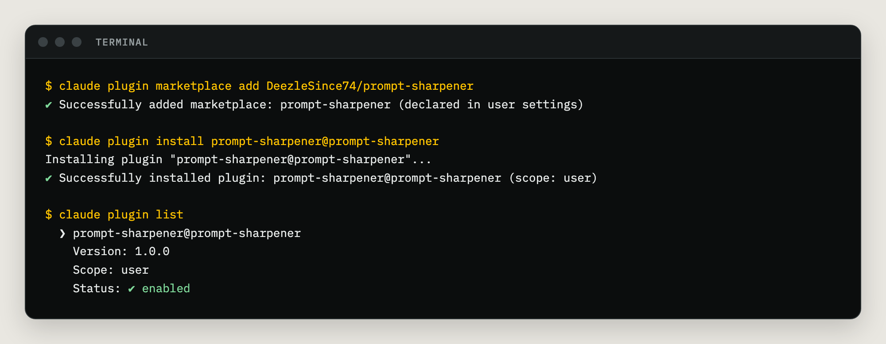
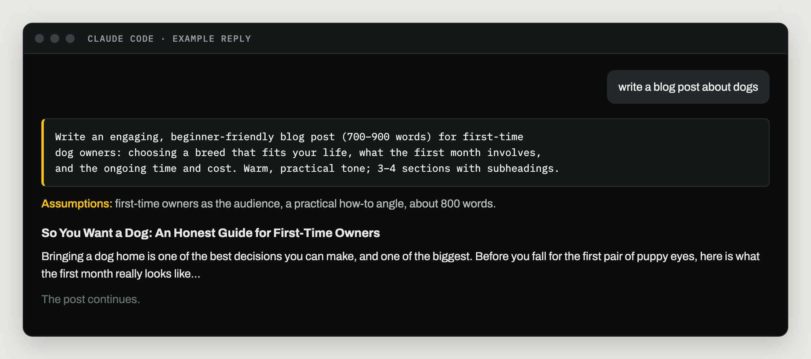
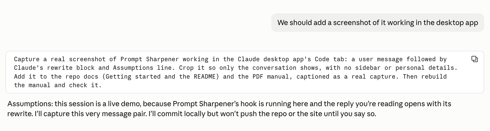

# Getting started

## What you need

| Item | Details |
| --- | --- |
| Claude Code | In the terminal, the desktop app's Code tab, or an editor extension. |
| Your computer | macOS, Linux or Windows. Nothing else to install: on Windows the hook runs with or without Git for Windows. |
| Search tools | Optional. Fact-checking uses whatever web search or fetch tools your session already has. |
| An account | None. The plugin has no server and needs no sign-in. |

## Install it

**From the plugin Directory.** Prompt Sharpener is listed in Anthropic's plugin
Directory for Claude Code, Cowork and the Claude apps. Open the plugin browser, search
for **Prompt Sharpener**, and install it.

**From GitHub.** In a Claude Code session, type:

```
/plugin marketplace add DeezleSince74/prompt-sharpener
/plugin install prompt-sharpener@prompt-sharpener
```

The first command adds this repository as a marketplace, which is a list of plugins
Claude Code can install from. The second installs the plugin from it. From a terminal,
the same steps are:

```bash
claude plugin marketplace add DeezleSince74/prompt-sharpener
```

```bash
claude plugin install prompt-sharpener@prompt-sharpener
```


*Real install output, October 17, 2026.*

**Then start a new session.** A session that is already running keeps the plugins it
started with.

## Your first message

Type a request the way you normally would. Short is fine.

```
write a blog post about dogs
```

The reply comes in three parts:

1. **The rewritten prompt**, in a code block. It fills in the audience, length, angle,
   tone and structure your request left open.
2. **One Assumptions line.** It lists the guesses Claude made to fill those gaps.
3. **The finished work**, done from the rewritten prompt, not your original words.


*Example reply, re-drawn to show the format.*

Here is the same thing for real, in the Claude desktop app's Code tab:


*Real screenshot from the Claude desktop app, October 17, 2026, trimmed to the conversation.*

**When a guess is wrong,** say so in your next message, for example "make it for
families with kids". Claude redoes the work with the fix.

**For very short requests,** like "what time is it in Tokyo", the rewrite shrinks to one
line that starts with "Taking this as:".

Next: [Using it](using-it.md)
