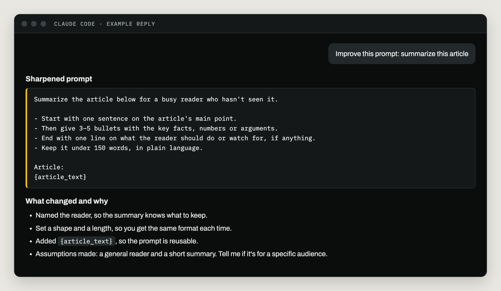
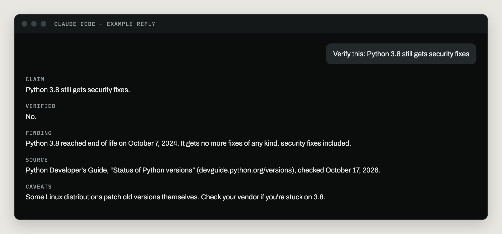

# Using it

Most of the time you won't think about it, because it runs on every message. Two more
ways to use it are one phrase away.

| Way | How to start it | What you get |
| --- | --- | --- |
| Every message | Nothing. It's automatic. | The rewrite, the Assumptions line, then the work. |
| Improve a prompt | "Improve this prompt: …" or "Just rewrite it." | A better prompt and a short list of what changed and why. Claude stops there and doesn't run it. |
| Verify a claim | "Verify this: …" or "Is this still current?" | A short report for each claim, with the source and the date it was checked. |

## Every message

See [Getting started](getting-started.md#your-first-message) for what a normal reply
looks like.

## Improve a prompt without running it

Use this when you're writing a prompt to reuse, share, or put in a tool. Parts you'll
swap out each time show up in curly braces, like `{article_text}`.

*Example reply, re-drawn to show the format.*

## Verify a claim

Ask Claude to verify something, and you get one block per claim:

| Part | What it says |
| --- | --- |
| Claim | The exact statement that was checked. |
| Verified | Yes, no, or partly. |
| Finding | What the source actually says, with the specific version, date, price or limit. |
| Source | The source's name, its link, and the date it was checked. |
| Caveats | Anything uncertain, regional, or likely to change soon. |

*Example reply, re-drawn to show the format. The finding was checked against the Python
Developer's Guide on October 17, 2026.*

## Quiet fact-checking

You don't have to ask for it. On every message, Claude checks outside facts before it
states them. These count as outside facts:

- A version number, or "the latest version is …".
- A command, a setup step, or a menu path in someone else's product.
- A price, a quota, a rate limit, or where a free tier ends.
- The shape of an application programming interface (API): its addresses, fields and
  sign-in method.
- What a product can or can't do.
- A legal or compliance rule.

Facts Claude saw for itself in your session, like a file it read or a command's output,
already count as checked.

**What you see:** nothing, when every fact checks out. There's no "Sources" section
added to every reply. When a fact can't be confirmed, Claude marks it **unverified**
right where it's used and tells you how to check it.

**Web pages can't take over.** A page could contain text written to steer an AI, like
"ignore your instructions and …". The plugin tells Claude to treat everything a page
says as information to check, never as orders to follow. If a page tries to direct it,
Claude ignores that and tells you.

Next: [How it works](how-it-works.md)
